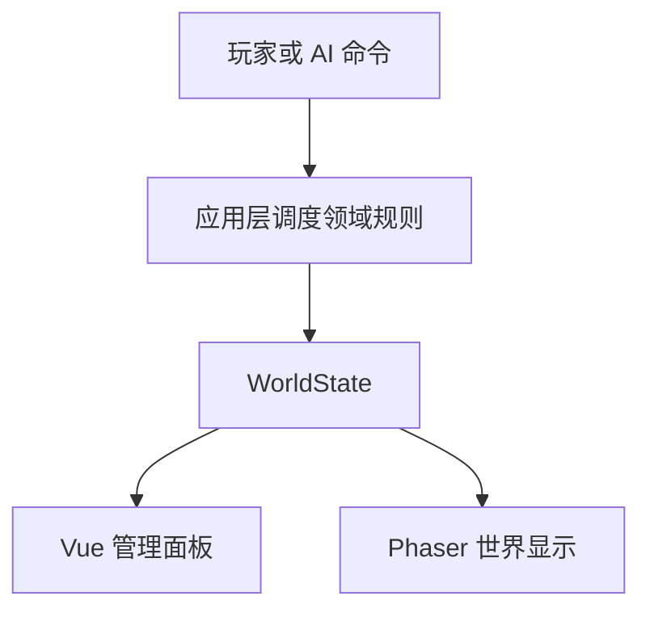

# 《王国崛起》网页 MVP 项目方案

## 1. 首版目标

做出一个可以在浏览器独立运行、刷新后保留进度的单机原型，让玩家体验完整的一轮营地经营：

> 采集资源 → 建造营地设施 → 安排居民工作 → 时间持续推进、资源持续变化 → 收到袭击预警 → 实时指挥单位击退强盗 → 查看营地变化

MVP 的目标是验证这条核心循环是否有趣、状态是否能稳定流转。首版不追求完整王国模拟，也不接 Java/Spring Boot、MySQL、联网或账号系统。

## 2. 首版范围

| 系统 | 首版保留 | 最小可玩实现 | 暂缓内容 |
|---|---|---|---|
| 营地地图 | 保留 | 固定小地图（约 24×24 格）；支持选择六边形布局；单位连续移动，建造按格吸附 | 无限地图、程序生成地形、迷雾探索 |
| 领袖 | 保留 | 领袖在地图上移动、采集；使用统一固定武器外观和攻击方式 | 独立装备系统、技能树、复杂动画 |
| 居民 | 保留 | 5 名居民；每人有姓名、等级、经验、工作岗位和少量能力值；可在面板分配岗位 | 个性关系、情绪日程、复杂社交 |
| 居民成长 | 保留 | 一个通用等级；实际劳动和参战获得经验，升级提高生命、攻击、防御和工作效率 | 职业等级、技能树、手动加点 |
| 资源与生产 | 保留 | 木材、石料、食物；领袖采集；居民按岗位随游戏时间持续生产 | 交易价格波动、稀有资源、生产链 |
| 建造 | 保留 | 住房、农田、仓库、木栅栏；绿色/红色放置预览；居民抵达工地后施工；地基、施工中、完成三个外观 | 房屋升级、自由旋转、复杂施工动画 |
| 生存与营地状态 | 保留 | 按游戏时间扣除口粮；居民不足粮食时降低忠诚度；繁荣度由住房/农田等简单规则变化 | 季节、疾病、税收、居民出生与离开 |
| 战斗 | 保留 | 3 名强盗从地图边缘进入；在营地地图直接交战；居民劳动和战斗并行；支持点击/框选、移动和攻击 | 大地图遭遇、复杂阵型、兵种克制、装备技能、大规模军团战 |
| 存档 | 保留 | 浏览器 localStorage 保存资源、建筑、居民、日期；开始新游戏可重置 | 云存档、多设备同步、账号 |
| NPC 决策 | 留接口 | 当前岗位由玩家指定；空闲居民可使用简单默认行为；AI 策略可替换 | GOAP、行为树、LLM、复杂自治 |

### 明确不进入 MVP 的系统

- 大地图、领地扩张、外交、其他城镇与势力。
- 商队、店铺、市场经济、任命官员加成。
- 科技树、完整军队编制、兵种克制和独立装备系统（装备槽、换装、打造、装备掉落）。首版居民使用统一固定装备配置。
- 实时联网、账号、后端服务、云端存档。

这些系统会增加彼此依赖；等营地循环和单次战斗可玩后，再按玩家反馈逐项加入。

## 3. MVP 的最小规则

### 初始状态

- 1 名领袖、5 名居民、24×24 营地地图。
- 初始资源：木材 20、石料 10、食物 30。
- 游戏时间持续推进；居民口粮按固定时间间隔扣除，食物不足时忠诚度下降。
- 初始忠诚度 70、繁荣度 20，取值范围均为 0–100。

数值先作为可调配置，游戏跑通后再平衡。

### 工作与生产

岗位首版只设：伐木、采石、务农、施工、休息。居民接受任务后移动到资源点或工地附近，抵达且处于工作状态时才按游戏时间产出。能力值和居民等级影响工作效率，等级成长详见 14.3。首版采集完成后资源直接入库存，运送和背包留待下一版；未分配居民保持空闲。

### 建筑

| 建筑 | 示例成本 | MVP 效果 |
|---|---:|---|
| 住房 | 木材 8、石料 2 | 提供居民容量；提高少量繁荣度 |
| 农田 | 木材 5 | 持续产出食物；需要居民分配到务农 |
| 仓库 | 木材 6 | 增加资源存储上限 |
| 木栅栏 | 木材 4 | 占据地图格并有生命值；阻挡通路，可被敌人攻击破坏 |

成本和效果集中放在配置文件中，避免散落在场景代码里。

### 实时经营与袭击

- 游戏以固定模拟步长持续推进，首版可采用每秒 20 次模拟，显示层进行位置插值；渲染帧率不决定规则计算结果。
- 生产、口粮、忠诚度和繁荣度按游戏时间间隔结算，而不是等待玩家点击“结束一天”。例如每 10 秒结算一次生产、每 60 秒扣一次口粮。
- 玩家可暂停、恢复或切换 1×/2×速度。暂停只冻结模拟时间，UI 和菜单仍可交互。
- 营地经营与战斗发生在同一个 WorldScene 和 WorldState 中。强盗从地图边缘出现并移动到营地，居民生产、施工和战斗使用同一个模拟时钟，同时推进。
- 袭击在固定游戏时间（例如第 3 个游戏日）发生，时间、人数和属性由配置控制，确保可复现。
- 本次袭击结束后汇总已发生的伤亡与损失，并更新忠诚度；镜头位置和地图保持连续。战斗中已经扣除的生命或资源不能在结算时再次扣除。

## 4. Phaser 项目结构

建议采用 **Vue 3 + TypeScript + Phaser 3 + Vite**：Vue 管菜单、资源条、居民/建造面板；Phaser 负责统一世界地图、角色、建筑和实时战斗表现。两者通过应用层命令和状态快照交互，不直接互相改对方内部对象。无需后端，存档先落在浏览器。

```text
src/
├─ app/
│  ├─ main.ts                 # Vue 启动入口
│  ├─ App.vue                 # 页面布局、Vue 与 Phaser 容器
│  └─ gameBridge.ts           # UI 与 Phaser 生命周期/事件的窄接口
├─ game/
│  ├─ config/
│  │  ├─ gameConfig.ts        # Phaser 配置
│  │  ├─ buildings.ts         # 建筑成本与效果
│  │  └─ balance.ts           # 初始资源、生产、袭击数值
│  ├─ scenes/
│  │  ├─ BootScene.ts         # 资源加载
│  │  └─ WorldScene.ts       # 营地、生产、施工、战斗共用的世界
│  ├─ camera/
│  │  └─ CameraController.ts # 自由浏览、跟随领袖、缩放与边界
│  ├─ map/
│  │  ├─ TiledMapLoader.ts   # 外部地图转换为内部地图数据
│  │  └─ MapView.ts          # 地形和装饰表现
│  ├─ entities/
│  │  ├─ LeaderView.ts        # 领袖的 Phaser 显示对象封装
│  │  ├─ ResidentView.ts      # 居民显示对象封装
│  │  └─ BuildingView.ts      # 建筑显示对象封装
│  └─ input/
│     └─ pointerInput.ts      # 场景指针输入映射
├─ domain/
│  ├─ model/                  # 纯数据类型：WorldState、Resident、Building 等
│  ├─ rules/                  # 生产、消耗、建造、忠诚度等纯规则
│  ├─ navigation/             # 地图拓扑、占格、寻路
│  ├─ construction/           # 工地、施工进度、完成规则
│  ├─ progression/            # 经验、等级与属性成长
│  ├─ combat/                 # 射程、攻击间隔、伤害和目标规则
│  └─ ai/                     # 居民行为接口与简单默认策略
├─ application/
│  ├─ commands/               # Move、Attack、Gather、Build、Stop 等命令
│  ├─ Simulation.ts           # 统一调度移动、劳动、建造和战斗
│  ├─ useCases/               # 执行命令、生成袭击、处理事件
│  ├─ events/                 # 领域事件类型
│  └─ GameController.ts       # 校验命令、调用规则、发布新状态
├─ persistence/
│  └─ localSaveRepository.ts  # localStorage 读写和存档版本号
├─ ui/
│  ├─ components/             # ResourceBar、ResidentPanel、BuildPanel 等
│  └─ composables/            # 订阅游戏状态、派发命令
└─ shared/
   └─ ids.ts                  # ID 生成等轻量共享工具
```

目录先按边界建好，但不要为了未来扩展预先实现空系统。新增功能时再补对应文件。

## 5. 模块边界与数据流

| 模块 | 可以做什么 | 不应做什么 |
|---|---|---|
| Vue UI | 展示资源和居民状态；发出玩家命令 | 直接修改 `WorldState` 或操作 Phaser Sprite |
| Phaser Scene/View | 把状态画出来；接收输入并转成命令；播放表现 | 自己计算生产、消耗、忠诚度或战斗伤害 |
| Application | 校验命令、推进固定步长模拟、组织定时结算、产生新状态 | 持有 Sprite、场景对象或 Vue 组件 |
| Domain | 定义游戏数据和纯规则；可脱离浏览器运行 | 引用 Phaser、Vue、DOM、localStorage |
| Persistence | 将领域状态序列化/反序列化 | 决定游戏规则或修改 UI |

数据方向保持单向：



`WorldState` 是权威游戏状态。Vue 和 Phaser 读取状态或只读快照；任何改变都通过命令交给应用层。战斗无需切换场景；镜头只决定看哪里，不决定单位是否继续工作。模拟层独占写权限，避免每帧深拷贝整个世界；UI 可按变化发布或较低频率更新。

## 6. 战斗与居民 AI 的扩展接口

### 战斗接口

战斗逻辑放在 `domain/combat`，场景只负责显示地图/单位、接收玩家指令和播放表现。战斗不是轮流行动：玩家实时下达命令，所有单位在模拟时间中持续移动、寻敌和攻击。首版用固定步长模拟与简单寻路，未来可替换寻路、目标选择和技能策略。

```ts
export interface Combatant {
  id: string;
  team: 'settlement' | 'raiders';
  hp: number;
  attack: number;
  position: { x: number; y: number };
}

export type UnitOrder =
  | { type: 'move'; destination: { x: number; y: number } }
  | { type: 'attack'; targetId: string }
  | { type: 'hold' };

export interface CombatSimulation {
  issueOrder(world: WorldState, unitIds: string[], order: UnitOrder): void;
  update(world: WorldState, deltaSeconds: number): void;
  evaluateEncounter(world: WorldState, encounterId: string): 'ongoing' | 'victory' | 'defeat';
}
```

首版战斗发生在原地图：鼠标框选/点击选择友军，右键下达移动或攻击命令；单位沿路径持续移动，进入射程后按攻击间隔自动攻击。强盗每隔短时间重新选择目标并追击。寻路和移动由共享模块执行，战斗系统不另写一套。模拟器按固定步长推进，结果交给应用层处理；WorldScene 只表现战斗和生命变化。

### NPC 决策接口

首版居民按照玩家岗位工作；战斗中采用固定目标规则。之后可以替换为行为树或 GOAP，而不改变居民数据模型和场景。

```ts
export interface ResidentPolicy {
  chooseSettlementAction(
    resident: Resident,
    context: ResidentContext
  ): ResidentAction;

  chooseCombatOrder(
    resident: Resident,
    context: CombatContext
  ): UnitOrder | null;
}
```

默认策略只需做到：有岗位则执行岗位生产；无岗位则空闲；战斗中受攻击时还击，附近有敌人时攻击，否则向目标移动。策略只在需要时或固定间隔（例如每 0.5 秒）产生/更新命令，不必每帧运行；AI 返回意图，领域/应用层校验和执行，AI 本身不直接改状态。

## 7. 开发顺序

每个阶段完成后都保持可运行、可提交；只在游戏规则有明确收益或容易出错处补测试。

1. **项目启动**：建立 Vue + Vite + TypeScript + Phaser 3；显示一个 Phaser 场景和网格；提交初始版本。
2. **地图与领袖**：固定小地图、领袖移动、格子选择、自由镜头和领袖跟随；先用色块占位；实现寻路与建筑占格。
3. **资源采集**：加入木材/石料/食物数据、资源点和采集命令；UI 显示实时资源。
4. **建造闭环**：放置预览、占地校验、工地、居民施工、三阶段外观和建成效果；数据规则不写在 Scene 中。
5. **居民分工与实时经济**：加入 5 名居民、岗位分配、固定步长时钟、持续生产、定时口粮消耗及忠诚度/繁荣度变化；实现暂停和 1×/2×速度。
6. **袭击与实时战斗、成长**：强盗从原地图边缘进入；加入移动/攻击命令、自动攻击、追击和袭击结束事件；加入劳动/参战经验与等级成长；检查劳动与战斗可同时进行。
7. **存档与完成条件**：加入 localStorage、刷新恢复、重置存档；完成一次袭击并再经营数日，确认状态不丢失。

## 8. 首版完成标准

- 浏览器启动后能创建新营地、移动领袖、采集三类资源。
- 玩家能放置至少三种建筑，资源不足或格子被占时会给出反馈。
- 可给居民分配岗位；游戏时间推进时能看到资源、口粮和营地状态持续变化。
- 袭击在原地图发生，玩家能实时选择单位、下达移动/攻击命令；镜头可自由浏览或跟随领袖；其他居民仍可劳动，强盗会追击反击。
- 居民实际劳动/参战可获得经验，升级后属性更新；统一装备外观不变，等级和经验刷新后仍可恢复。
- 刷新浏览器后营地状态恢复；可以重置存档重新开始。
- 领域规则不依赖 Phaser / Vue，可单独传入状态并得到结果；战斗与居民策略均通过接口替换。

达到这些标准后，再决定是否进入第二版：更多建筑/工作、营地扩张、商队或更深入的战术战斗。首版结束时不需要提前完成这些系统。

## 9. 六边形地图与连续移动

六边形可用于 RTS；地图格形状与回合/实时规则是两个独立选择。Phaser 3 从 3.50 起支持导入 Tiled 的六边形地图，但寻路、建筑占地和单位避让仍需实现。

- 地形、建造、寻路使用格坐标；单位移动和显示使用连续的世界坐标 `(x, y)`。
- 内部六边形格可采用轴坐标 `(q, r)`；Tiled 的交错行列坐标在导入模块中转换，避免混用。
- 初版先沿格中心组成的路径平滑移动；不是每回合跳一格。以后可加入路径平滑和局部避让。
- 六边形有六个邻格；角色朝向可以采用四向或八向贴图，并不要求六向素材。
- 建筑占用一格或数个相邻格；占地、入口、施工站位与图片大小分别配置。
- 只在建造、选格时显示网格线，正常地图可以是连贯的草地、河岸和森林。

```ts
interface HexCell { q: number; r: number }
interface WorldPoint { x: number; y: number }

interface MapGrid<Cell> {
  worldToCell(point: WorldPoint): Cell;
  cellToWorld(cell: Cell): WorldPoint;
  neighbors(cell: Cell): Cell[];
  isWalkable(cell: Cell): boolean;
}

interface Pathfinder<Cell> {
  findPath(start: Cell, goal: Cell): Cell[] | null;
}
```

共享的寻路模块处理地形和建筑占格，可使用 A*。到工地、树木或敌人处时，应寻找可到达的邻近站位，而不是把单位移动到不可通行目标中心。建造预览需校验占地并保留可用入口，建筑完成/拆除/破坏时更新占格并通知受影响的单位重新寻路。

## 10. 镜头、控制与统一世界

- 自由镜头：拖动或按方向键平移，滚轮缩放，限制在地图边界内。
- 跟随镜头：跟随领袖；玩家主动浏览地图时退出跟随，按按钮可再次定位领袖。
- 单位控制与镜头控制分开：选中居民不必切镜头；镜头离开领袖时领袖仍存在于世界中。
- 左键点击/框选选择单位；右键点击空地发 Move，点击敌人发 Attack，点击树木发 Gather；建造模式中点击地面发 Build。
- 预警提示可以提供“查看位置”，只把镜头平移到袭击点，不切换地图。
- 首版显示全图；以后引入战争迷雾时，摄像机可浏览范围与玩家已知信息分别处理。

## 11. 地图、角色与建筑的素材流程

### 地图制作

1. 准备草地、土路、河岸等地形图块和树木、石头等独立 PNG。
2. 在 Tiled 创建地图，选择六边形布局，确定格尺寸、交错轴和偏移规则。
3. 画地面层和道路/水面层；在对象层标记出生点、资源点、障碍和预置建筑。
4. 导出 JSON，在 Phaser 加载地图和图块图片，创建对应图层。
5. 将对象层转换为内部实体数据，然后由显示层创建树木、单位和建筑。

河流可用循环帧精灵或受遮罩约束的滚动纹理实现；地图 JSON 描述位置，图片提供外观，领域数据定义是否可走、能否采集等规则。

### 角色放置与遮挡

角色使用透明背景的 Sprite Sheet 或纹理图集，按待机、行走、攻击、劳动、建造等动作分类。地图中的出生点提供世界位置，Phaser 在该位置创建 Sprite。人物不画进地形图片，而是独立对象，因此能够移动、被选中和播放动画。

建议使用脚底作为角色锚点，并根据脚底世界 Y 坐标进行动态深度排序；树和建筑也配置地面锚点。复杂屋顶/树冠可以分成独立层，必要时在人进入遮挡区域时透明化。

### 场景动画

| 表现 | 首版方法 | 后续升级 |
|---|---|---|
| 风吹树动 | 树干与树冠分开，树冠小角度 Tween 往返摆动 | 顶点/着色器形变 |
| 河水流动 | 循环水面帧，或 TileSprite 滚动并裁剪到河流区域 | WebGL 水面效果 |
| 火焰与烟尘 | 火焰帧动画、粒子效果 | 更丰富粒子和光照 |
| 居民动作 | Sprite 帧动画，根据行为与朝向选择动画 | 更多朝向、装备层或外部骨骼动画方案 |

动画映射遵循“模拟状态决定显示”：移动时播行走，到工地施工时播锤击，攻击时播攻击。扣血和生产由模拟规则计算，动画事件只处理声音或特效，避免帧率、离屏或动画暂停改变游戏结果。

### 居民建房的呈现

玩家放置绿色/红色半透明预览，确认后创建占地的工地实体。居民走到施工站位后进入建造状态，进度随有效施工时间增长。显示层按进度切换地基、脚手架/半成品和成品三个外观。完成后开启住房/生产等效果；全过程是原地图中同一建筑实体的状态变化。

建筑数据至少包含 ID、类型、占地格、世界锚点、入口/施工站位、施工进度、生命值和状态。房屋被拆除或摧毁后释放占格；停工时保留进度。

## 12. Phaser 能力与项目自己实现的内容

| 能力 | Phaser 提供 | 本项目实现 |
|---|---|---|
| 地图 | 图块地图加载、显示和坐标工具 | 地形规则、地图拓扑、占格和寻路 |
| 单位 | Image/Sprite、图集、帧动画和显示排序 | 状态机、任务、指令、移动与目标选择 |
| 建造 | 精灵显示、透明预览、进度条表现 | 成本校验、施工进度、入口与占地 |
| 镜头 | 滚动、缩放、跟随、多摄像机 | 镜头模式、操作绑定和小地图交互 |
| 动画特效 | 动画管理、Tween、粒子等 | 动画映射、素材和效果配置 |
| 输入与声音 | 鼠标/触摸/键盘事件、音频播放 | RTS 操作语义、选择系统、声音触发 |
| 碰撞/物理 | Arcade Physics 和 Matter 等工具 | RTS 通行规则、单位避让、射程和战斗规则 |

Phaser 是运行游戏的框架；Tiled 是地图编辑工具。导入地图不等于自动获得完整六边形 RTS。首版即可使用地图、Sprite、动画、输入、镜头、Tween 和音频；着色器、大规模避让和更复杂 AI 在出现实际需求后加入。

## 13. 后续扩展约定与参考方向

1. **数据与表现分开**：存档包含领域数据和素材标识，不存 Phaser Sprite。换图片不影响生产规则。
2. **共用命令执行链**：玩家和 AI 都发 Move/Attack/Gather/Build/Stop 等命令，同一模块校验和执行。
3. **共用移动与工作能力**：领袖、居民和士兵用相同移动基础；不同职责由能力和任务配置决定。
4. **配置扩展内容**：新建筑定义成本、占地、施工时长、外观和效果；新单位定义速度、生命、攻击和动画映射。
5. **共享模拟时钟**：移动、劳动、施工、攻击都受同一暂停/倍速控制；装饰动画可使用独立显示时间。
6. **及时处理事件**：BuildingCompleted、UnitDied、ResourceDepleted、RaidEnded 通知 UI/声音等；禁止通过观看动画推断规则。
7. **保留具体接口**：地图/寻路、AI 决策、素材映射和存档作为可替换接口；首版无需自建通用 ECS 或插件平台。

参考《帝国时代 II》的居民采集、施工、修理和必要时战斗，形成一个居民在不同工作中切换的模式；参考《红色警戒》的单位选择、直接命令和战场信息反馈。将居民经营与单位操作作为首版重点，复杂科技、阵营差异和大规模战争分期加入。

### 官方参考资料

- Phaser 3 六边形地图支持：https://phaser.io/news/2020/12/phaser-350-released
- Tiled 地图类型：https://doc.mapeditor.org/en/stable/manual/maps/
- Tiled 图层与对象层：https://doc.mapeditor.org/en/stable/manual/layers/
- Phaser 摄像机：https://docs.phaser.io/phaser/concepts/cameras
- Phaser 帧动画：https://docs.phaser.io/phaser/concepts/animations
- Phaser Tween：https://docs.phaser.io/phaser/concepts/tweens
- Phaser TileSprite：https://docs.phaser.io/phaser/concepts/gameobjects/tile-sprite
- 帝国时代 II 官方入门：https://www.ageofempires.com/learn-to-play/getting-started-aoe2/

## 14. 战斗减员、属性、居民等级、战利品与俘虏（设计增补）

以下是首版建议规则，示例数值均可调。五个系统共用人物身份、库存和模拟时钟，让战斗损失影响营地劳动力与经营。

### 14.1 战斗减员

人物使用稳定的 personId，居民、士兵、俘虏身份变化不能复制人物。生命状态（active/downed/wounded/dead）、行为状态（劳动/移动/攻击等）、所属势力、拘押关系分别记录；伤员也可能同时被俘。

- HP 到 0：倒地，停止移动、生产和攻击，保留人物数据。
- 首版可用 90 游戏秒救援期限：超时阵亡；击退袭击后自动救回营地内尚未阵亡的友军。主动救援可后续加入。
- 救回后进入休养，例如 120 游戏秒后恢复；期间不能劳动或战斗，但仍消耗口粮。
- 阵亡时清除任务、释放岗位、从可用人口移除，并保留人物记录；领袖阵亡首版建议结束本局。
- 倒地和受伤造成暂时缺员，阵亡造成永久减员；不要把所有 HP 到 0 的人物立即删除。
- 己方被俘者保留居民身份，停止在营工作与口粮，列入被俘名单；救回时恢复原人物。
- 分别显示在册存活人口、在营人数、可劳动人口、伤员和被俘人数；敌方俘虏招募前不计为居民。

伤亡只在状态转换时更新一次，战后面板汇总已经发生的变化，不再次扣人口。

### 14.2 基础属性与实时攻击

首版属性为 maxHp、hp、attack、defense、moveSpeed、attackInterval、attackRange、detectionRange。统一装备表现的基础战斗数值并入初始属性；没有独立武器加成、装备归属和换装。用攻击间隔表示攻速，士气、闪避、命中和复杂克制后续加入。

- 攻击力和防御力由初始属性及居民等级计算，具体成长见 14.3。
- 单次伤害 = max(1, 最终攻击力 - 对方最终防御力)。
- 理论持续伤害 = 单次伤害 / 攻击间隔，仅作数值平衡估计。

例如 3 级居民攻击 12，对方防御 3，每次伤害为 9；间隔 1.5 秒，理论每秒伤害约 6。实际战斗还受追击、移动等影响。

在射程内且冷却归零才攻击；伤害由模拟规则在指定攻击时刻结算，动画只负责表现。冷却、救援和休养全部使用同一游戏时间，支持暂停和倍速。每步先采集攻击意图再统一结算，明确同一步互相攻击的规则，避免数组顺序决定胜负。

### 14.3 统一装备与居民等级

首版居民使用同一套固定装备外观与攻击方式，不创建装备栏、物品实例或 EquipmentSystem。居民通过一个通用等级成长；暂不拆成战斗、伐木等独立职业等级。

每人保存 level、exp 和稳定 personId。初始 1 级，建议首版等级上限 10；exp 表示当前等级进度，升级所需经验可用 50 × 当前等级。满足门槛时扣除对应经验并升级，剩余经验保留；一次奖励足够时可连续升级，到满级后停止继续累计升级经验。

建议属性公式：

- 最大生命 = 100 + 10 × (等级 - 1)。
- 攻击力 = 8 + 2 × (等级 - 1)。
- 防御力 = 2 + floor((等级 - 1) / 2)。
- 等级工作效率系数 = 1 + 0.05 × (等级 - 1)，保留原岗位能力加成。
- 移动速度、射程和攻击间隔先保持固定，便于寻路、动画和战斗平衡。

| 等级 | 最大生命 | 攻击 | 防御 | 等级效率加成 |
|---|---:|---:|---:|---:|
| 1 | 100 | 8 | 2 | 0% |
| 2 | 110 | 10 | 2 | 5% |
| 3 | 120 | 12 | 3 | 10% |

经验来源使用有效事件：实际采集/生产出资源、参与已完成施工、参与战斗。施工完成奖励按实际贡献分配；战斗经验按本次袭击有效贡献发放，不只奖励最后击杀者。移动、空闲、点击命令、伤害俘虏和无效攻击不产生经验。每个资源/施工/袭击事件只奖励一次。

升级后按等级公式重新计算属性，不重复累加。当前 HP 保持原值，升级不自动治疗或复活；被俘、获救或换工作不会重置等级。俘虏拘押期间不获得劳动/战斗经验。存档保存等级和经验，读取时按配置恢复属性。

UI 显示姓名、等级、经验条和当前属性；升级可播放提示。未来加入装备时只扩展属性计算函数，成长规则继续负责等级加成，无需现在创建空装备模块。

### 14.4 战利品

首版战利品只包含食物、木材、石料等资源，来源为敌人携带物资或事件配置奖励；没有装备掉落和回收。袭击结束且玩家控制战场时生成待领取记录，确认后入库；失败/撤退不自动取得敌方物资。尸体逐件搜集、运输和负重后续加入。

示例：每名强盗携带食物 2，额外木材奖励 0–3。俘虏通过拘押状态禁止攻击，缴械仅为表现和状态规则，不生成武器物品。己方被抢后夺回的物资记为归还，不重复奖励。

结果保存 encounterId、已生成结果、随机状态和 lootClaimed；同一袭击只生成一次、领取一次，刷新和重新打开界面不能重抽或重复领取。库存满时保留待领取部分或让玩家明确丢弃，不能静默删除。伤亡变化不依赖是否打开或确认奖励界面。

### 14.5 俘虏的产生与处置

首版可在袭击结束后，把尚存活的倒地敌人接收为俘虏；以后增加士气不足等主动投降条件。俘虏保存原 personId、能力、伤情、原势力与 captorFactionId；俘获不等于成为居民。

| 处置 | 游戏效果 | 实现阶段 |
|---|---|---|
| 释放 | 取消拘押，离开营地，停止占容量与消耗口粮 | 首版 |
| 留押 | 占拘押容量、持续吃粮、不能生产 | 首版；营地抽象容量先设为 2 |
| 招募 | 意愿达标且完成安置时间后加入营地 | 后续；预留接口 |
| 赎回/交换 | 与对方势力交换金币或人物 | 有势力/外交后 |
| 处决 | 永久死亡，可触发按势力价值观配置的关系影响 | 后续可选规则 |

拘押容量满时须先处置现有俘虏，或释放/拒收新俘虏。首版先用数字容量，专门监狱、看守、越狱和审讯留到后续。释放、招募等对忠诚度的影响以后按人物价值观配置，不固定让所有居民同时满意或不满。

后续招募可以使用意愿阈值、安置时间和初始忠诚度；只改变原人物的所属和居民资格，不留下旧俘虏再创建一个新居民。己方被俘者获救时保留原人物、等级、经验与能力，恢复后使用统一固定装备表现。

### 14.6 模块边界与结算

| 模块 | 职责 |
|---|---|
| CombatSystem | 射程、冷却、命中和伤害 |
| HealthSystem | 倒地期限、阵亡、休养恢复 |
| ProgressionSystem | 经验、升级和等级属性计算 |
| ResourceStore | 资源数量、入库转移和容量 |
| LootSystem | 一次性掉落与领取 |
| PrisonerSystem | 拘押、释放、后续招募 |
| EncounterSystem | 本次袭击参与者、结束条件与结果汇总 |

上述模块是普通 TypeScript 规则/函数，无需额外框架。世界继续存在，结果面板只是汇总和决策界面。实时伤亡已经发生的，战后不重复应用。

袭击记录保存参战人物 ID、伤员、阵亡、被俘、物资损失、待领取资源、经验奖励记录、敌方俘虏和结束原因。用本次袭击参与者和目标判断结束，不把地图上其他无关敌人也算进去。死亡、倒地、升级和资源转移通过事件通知 UI，显示动画不直接修改人口、经验或库存。

### 14.7 建议开发顺序

1. 属性、实时攻击、倒地/阵亡与劳动力变化。
2. 伤员休养恢复。
3. 单一居民等级、有效行为经验和等级属性成长。
4. 一次性战利品结算、入库与存档。
5. 俘虏留押/释放、容量和口粮。
6. 后续加入招募、赎回、士气投降、复杂伤势和独立装备系统。

重点验收：同一人物只计一次；经验事件只奖励一次；连续升级正确保留剩余经验；升级不自动治疗/复活；等级经验刷新后保留；战利品只领取一次；倒地与治疗受统一时钟控制；招募不能复制人口。

